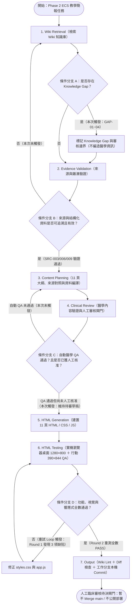
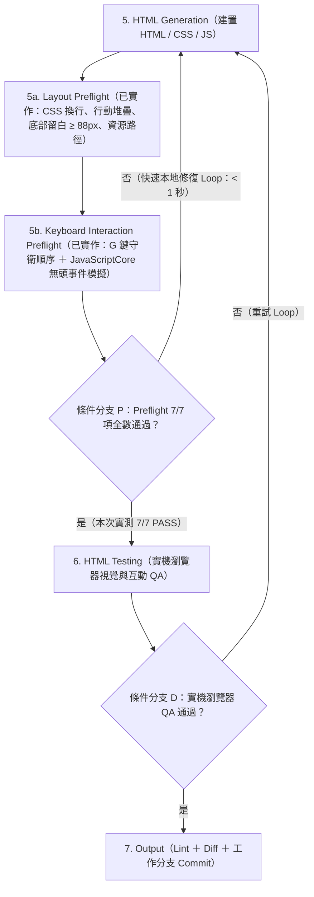

# Phase 2 Workflow Loop / Graph 說明與反思報告
## Reproductive Genetics & Laboratory Wiki — ECS 互動式教學簡報實作紀錄

- **專案名稱**：Reproductive Genetics & Laboratory Wiki（`igene-lab-wiki`）
- **實作標的**：11 頁互動式教學 HTML 簡報《ECS 是什麼？為什麼健康的父母也可能生下患有遺傳疾病的孩子？》（`presentations/ecs-teaching-slides/index.html`）
- **Git 工作分支**：`content/ecs-teaching-slides`（未合併至 `main`、未 Push、未部署 GitHub Pages）
- **唯一事實依據（Execution Logs）**：
  1. `logs/phase2/retrieval_log.md`
  2. `logs/phase2/content_validation_log.md`
  3. `logs/phase2/html_test_log.md`
  4. `logs/phase2/git_change_log.md`
  5. 新增改進流程實測紀錄：`logs/phase2/preflight_report.md`（由 `workflows/preflight_slides.py` 實作執行）
- **撰寫日期**：2026-11-23

---

## 1. Agent Workflow Graph（Mermaid 流程圖）

### 1.1 原始執行架構（Workflow v1 — 本次實際執行並於 HTML Testing 觸發重試）

### 1.2 改進後執行架構（Workflow v2 — 已實作並實測前置 Preflight 閘門）

針對 Round 1 實測暴露的 3 項缺陷，本專案已實際撰寫並執行 `workflows/preflight_slides.py`，於 `HTML Generation` 與 `HTML Testing` 之間插入 **Layout Preflight** 與 **Keyboard Interaction Preflight**，將低成本可靜態／無頭驗證的缺陷提前攔截於啟動瀏覽器之前：

---

## 2. 條件分支（Conditional Branches）與重試迴圈（Retry Loops）說明

| 類型 | 位置節點 | 判斷條件 | 本次實測是否觸發 | 實際執行紀錄依據 |
| :--- | :--- | :--- | :---: | :--- |
| **條件分支 A** | `Wiki Retrieval` 後 | 檢索之 Wiki 是否缺少零基礎詞彙、特定遺傳對照、技術參數或尚未人工核准 | **是（觸發）** | `retrieval_log.md`：記錄 `GAP-01`（零基礎詞彙頁缺口）、`GAP-02`（父親 X-linked 傳遞補充）、`GAP-03`（ECS 機型／Coverage／TAT 待驗證）、`GAP-04`（全站 `pending_clinical_review`） |
| **條件分支 B** | `Evidence Validation` 後 | `SRC-003`、`SRC-006`、`SRC-009` 及結構化 JSON 是否有效可追溯；若否則退回 `Wiki Retrieval` | 否（全數通過） | `retrieval_log.md`：`raw/metadata/SRC-003.json`、`SRC-009.json` 與 350 筆結構化清單均為 `ingested` |
| **條件分支 C** | `Clinical Review` 後 | ① 自動醫學 QA 是否全數符合護欄（若否則退回 `Content Planning`）；② 是否已獲授權醫師／主管簽核（未核准則只能產出「待審草稿」，禁止 Merge 至 `main`） | **部分觸發（人工待審閘門生效）** | `content_validation_log.md`：11/11 頁自動醫學 QA 通過；全站維持 `pending_clinical_review` / `pending_technical_verification`，僅於工作分支本機 Commit |
| **重試 Loop 1（v1 實測觸發）** | `HTML Testing` → `修正程式碼` → `HTML Testing` | 桌面／行動實機瀏覽器功能與視覺 QA 是否 0 缺陷 | **是（觸發 1 次重試）** | `html_test_log.md`：Round 1 發現 3 項問題（2 項行動版排版 FAIL、1 項快捷鍵 PARTIAL）→ 修正 `styles.css` 與 `app.js` → Round 2 重測全數 PASS |
| **重試 Loop 2（v2 已實作新增）** | `Layout / Keyboard Preflight` → `HTML Generation` | 執行 `workflows/preflight_slides.py`（7 項檢查）是否全數 PASS | **已實作並完成回歸驗證** | `preflight_report.md`：現行檔案 `7/7 PASS`；於記憶體還原 Round 1 舊條件實測可攔截全部 3 項缺陷（`LAYOUT-01/02/03`, `KEY-01/03`） |

---

## 3. 各節點實際失敗次數統計（嚴格依據 4 份執行紀錄）

以下數據完全彙整自 `retrieval_log.md`、`content_validation_log.md`、`html_test_log.md` 與 `git_change_log.md`（單次完整 Phase 2 執行，`N = 1`）：

| Workflow 節點 | 實際執行次數 | 失敗／未通過次數 | 實際觸發之重試次數 | 實錄備註 |
| :--- | :---: | :---: | :---: | :--- |
| **1. Wiki Retrieval** | 1 輪（14 份檔案） | **0** | 0 | 14/14 讀取成功；辨識 4 項 Knowledge Gaps（屬條件分支處置，非檢索失敗） |
| **2. Evidence Validation** | 1 輪 | **0** | 0 | `SRC-003`、`SRC-006`、`SRC-009` 與 350 筆 JSON 均驗證通過 |
| **3. Content Planning** | 1 輪 | **0** | 0 | 產出 11 頁大綱對照表與 `igene_data.js`（350 筆） |
| **4. Clinical Review** | 1 輪（11 頁） | **0（自動 QA）** | 0 | 自動醫學內容 QA 11/11 PASS；人工臨床審核目前處於「待人工確認（Hold）」狀態，非錯誤失敗 |
| **5. HTML Generation** | 2 次（初版＋修正） | **0（建置失敗）** | 0（由測試節點退回觸發修正） | 建置與靜態語法均成功，但初版 CSS/JS 潛藏 3 項缺陷於下游 `HTML Testing` 才暴露 |
| **6. HTML Testing** | 2 輪（Round 1 ＋ Round 2） | **1 輪未全過（共 3 項缺陷）** | **1 次重試 Loop** | Round 1：`Mobile Visual FAIL`（2 缺陷）＋ `Navigation PARTIAL`（1 缺陷）；Round 2：0 缺陷（全數 PASS） |
| **7. Output（Lint / Diff / Commit）** | 1 輪 | **0** | 0 | `lint_wiki.py` PASS（0 Errors / 0 Warnings）、`git diff --check` PASS、Secret/PII 0 筆、Commit `74d9a24` |

> **統計方法論聲明（避免過度推論）**：本次紀錄僅代表單次專案實作（`N = 1`）。雖然此次唯一記錄到失敗與重試的節點是 `HTML Testing`（3 項缺陷、1 次重試），但**不可僅憑單次執行數據宣稱「HTML Testing 在所有專案中永遠最常出錯」**；不同任務中若遇到新來源被封鎖或跨指引醫學爭議，失敗點亦可能落在 `Evidence Validation` 或 `Clinical Review`。

---

## 4. 真實錯誤案例分析（Round 1 發現位置、根因與修正驗證）

所有案例均取自 `logs/phase2/html_test_log.md` 之真實實機瀏覽器測試紀錄：

### 案例一：行動版（`390×844`）Slide 7 頁首水平裁切（FAIL）
- **第一輪發現位置**：`HTML Testing`（Round 1）— 行動視窗 `390×844` 檢視 Slide 7（`#slide-7`）。
- **實測現象與數據**：`.slide-head`（寬 `335 px`）未設定換行，當右側 `.head-right` 同時包含長審核徽章（`product_spec_verified｜待臨床審核`）與 `biolove-4.png`（寬 `303.1 px`）時，將 Logo 推至 `x: 321.8..401.7`（超出 `390 px` 視窗右緣、裁切掉半個標誌），並把左側 `.kicker` 擠壓至僅 `59 px`（折成 8 行窄字）。
- **根本原因**：桌面 16:9 寬度充裕（`1228.8 px`），靜態閱讀 CSS 時忽略了窄螢幕上單列 Flex 容器內「長中英混排徽章＋圖片」的最小寬度總和。
- **修正方法（`presentations/ecs-teaching-slides/styles.css`）**：為 `.slide-head` 與 `.head-right` 加上 `flex-wrap: wrap` 與 `max-width: 100%`，並於 `@media (max-width: 860px)` 將 `.slide-head` 改為 `flex-direction: column; align-items: flex-start;`、`.head-right` 設 `width: 100%; justify-content: space-between;` 與允許 `.status-badge` 自動換行。
- **第二輪實測驗證**：`.kicker` 滿寬佔第一列（`339 px`），`.head-right` 排於第二列，`biolove-4.png` 右緣 **`364.5 px ≤ 390 px`**（零裁切）。

### 案例二：行動版（`390×844`）底部固定控制列遮擋長頁底緣（Minor/Moderate）
- **第一輪發現位置**：`HTML Testing`（Round 1）— 行動視窗 `390×844` 檢視 Slide 1、Slide 3 與 Slide 7。
- **實測現象與數據**：行動版單欄堆疊後 `.stage` 高度超過 `844 px`（達 `903–1089 px`），底部 `.deck-shell` 僅預留 `76 px` 內距，造成捲動至底前／底端時固定式 `.controls` 易貼近或遮蔽頁尾文字與卡片底緣。
- **修正方法（`presentations/ecs-teaching-slides/styles.css`）**：將行動版 `.deck-shell` 底部留白由 `76 px` 提高至 `96 px`，縮小行動版 `.controls` 與 `.ctrl-btn` 內距，並將 `.slide-foot` 改為直向排布。
- **第二輪實測驗證**：捲動至 Slide 7 底部時，`.slide-foot` 底緣位於 `y = 726.46`，固定控制列頂緣位於 `y = 792`，保有 **`65.54 px`** 安全間距。

### 案例三：目錄總覽快捷鍵 `G` 僅能開啟、無法再次按 `G` 關閉（PARTIAL）
- **第一輪發現位置**：`HTML Testing`（Round 1）— 桌面視窗 `1280×800` 測試鍵盤導覽與目錄總覽彈窗。
- **實測現象與數據**：按 `G` 可開啟 11 頁目錄彈窗，但彈窗開啟狀態下再按 `G` 無反應，只能點選「關閉」或按 `Esc`。
- **根本原因**：`presentations/ecs-teaching-slides/app.js` 的 `keydown` 監聽器將阻擋翻頁的 `if (!overviewModal.classList.contains("hidden")) return;` 寫在 `e.key.toLowerCase() === "g"` 判斷之前，導致彈窗開啟後提早 `return`，連帶阻斷了 `G` 鍵本身。
- **修正方法（`presentations/ecs-teaching-slides/app.js`）**：將 `g` 鍵切換邏輯移至 `overviewModal` 開啟守衛之前並立即 `return`。
- **第二輪實測驗證**：`overviewModal` 顯示狀態實測為 `false → 按 G → true → 再按 G → false`，雙向切換正常。

---

## 5. Workflow 改進實作與新舊流程對照（v1 vs. v2）

為避免只停留在「口頭建議」，本次已**實際實作並執行** [workflows/preflight_slides.py](file:///Users/chiaweikao/Desktop/Genetics%20Wiki%20Notes/workflows/preflight_slides.py)，落地以下兩項前置檢查：

1. **已實作 — `Layout Preflight`（`LAYOUT-01` 至 `LAYOUT-04`）**：
   - 自動檢查 `.slide-head` 是否具備 `flex-wrap: wrap`；
   - 自動檢查行動版 `@media` 是否對 `.slide-head` 設定 `flex-direction: column`；
   - 自動解析行動版 `.deck-shell` 底部內距是否 `>= 88px`；
   - 自動檢查 11 頁投影片數量與所有本機圖檔／連結路徑完整性。
2. **已實作 — `Keyboard Interaction Preflight`（`KEY-01` 至 `KEY-03`）**：
   - 靜態檢查 `g` 鍵監聽器順序是否位於 `overviewModal` 阻擋守衛之前，並確認 `<input>/<textarea>/<select>` 聚焦防誤觸守衛存在；
   - 透過 macOS 內建 **JavaScriptCore（`jsc`）** 啟動無頭 DOM 模擬器，真實觸發 `g`（第 1 次開、第 2 次關）、`Escape` 關閉、在 `<input>` 內按 `ArrowRight` 不誤翻頁，以及正常左右鍵翻頁測試。

### 新舊 Workflow 實際差異對照表

| 比較維度 | 舊流程（Workflow v1，實測於 Commit `74d9a24`） | 新流程（Workflow v2，已實作 `preflight_slides.py` 並實測） |
| :--- | :--- | :--- |
| **HTML 生成後至瀏覽器測試前之檢查** | 僅做 HTML 路徑檢查與 JS 語法編譯（不檢 CSS 響應式規則、不檢鍵盤事件狀態機） | 新增 **7 項自動化 Preflight**（`LAYOUT-01`–`04` ＋ `KEY-01`–`03` 無頭 DOM 模擬），耗時 `< 1 秒` |
| **對 Round-1 三項真實缺陷之發現時機** | 直到啟動本機伺服器並由瀏覽器代理逐頁實測（Round 1）才發現，須額外跑完 Round 2 全套瀏覽器重測 | 經 `preflight_slides.py` 還原 Round-1 舊條件驗證，**全部 3 項缺陷均於啟動瀏覽器前即被攔截**（觸發 `LAYOUT-01/02/03`、`KEY-01`、`KEY-03`） |
| **現行修正版實測狀態** | Round 2 實機瀏覽器 QA 全數 PASS | `workflows/preflight_slides.py` 實測 **`7 / 7 PASS`**（詳見 `logs/phase2/preflight_report.md`） |
| **尚未實作之進階建議（明確標示）** | — | ① **自動化多視窗像素回歸截圖比對**（如 Playwright Visual Diff）；② **CI/CD 自動觸發 Preflight 與 Wiki Lint**（如 GitHub Actions）。此兩項目前**尚未實作**，留待後續階段評估。 |

---

## 6. 課堂繳交反思摘要（Reflection）

### 6.1 為什麼「Persistent LLM Wiki（Wiki-First）」比直接叫 LLM 生成教材更可靠？
若直接請 LLM 從頭撰寫「ECS 衛教簡報」，模型極容易出現三種典型錯誤：① 將官網「350 種疾病」隨手寫成「350 個基因」；② 憑印象將 *FMR1*（X 染色體脆折症）列入 NGS 帶因清單；③ 自行捏造或引用 Thermo Fisher 原廠規格代替本實驗室未驗證之 Coverage 或 TAT。本專案透過「先查 `wiki/index.md` → 讀取整合頁與結構化 `SRC-009` JSON → 自動編譯 `igene_data.js` → 產出 `content_validation_log.md` 逐頁對照」的強制流程，成功將「350 疾病 vs. 351 獨立基因（`HBA1/HBA2`）」、「不含 *FMR1* 跨來源差異」與「僅列已確認之 Ion Torrent / 530 晶片、其餘維持待驗證」等精細醫學與技術邊界完整帶入教材，達成單一事實來源（Single Source of Truth）。

### 6.2 為什麼 `Clinical Review` 必須保留為不可自動跨越的人工閘門？
檢視 `retrieval_log.md` 可見，即使我們已完整擷取 ACMG 2021 與 iGene 官方清單，全站所有 ECS 相關頁面目前仍處於 `pending_clinical_review` / `pending_technical_verification`。AI Agent 可以透過自動化檢查確保「每個宣稱都有引用、沒有誇大零風險、沒有捏造未確認數值」，但**最終醫療衛教口徑、在地臨床轉介路徑與正式實驗室 Validation Report 的責任歸屬，仍必須由授權醫師、遺傳諮詢師與實驗室主管簽核**。透過 Git 分支隔離（停留在 `content/ecs-teaching-slides`，不自動 Merge 至 `main` 或啟用 GitHub Pages），讓「技術產出」與「正式臨床發布」在工程制度上徹底解耦。

### 6.3 實機瀏覽器測試與前置 Preflight 的互補教訓
第一輪僅看 HTML/CSS 原始碼與通過 JavaScriptCore 語法檢查時，簡報在邏輯上看似完全正確；然而一旦真的放到 `390×844` 手機視窗中量測座標，立刻暴露了 Slide 7 長徽章擠爆頁首把 Logo 切掉一半的真實問題，操作鍵盤也抓出 `G` 鍵被 modal guard 擋住的狀態機盲點。這印證了兩件事：**① 永遠不能只靠讀原始碼宣稱前端測試成功；② 每一次真實 QA 抓到的缺陷，若能轉化為可重複執行的低成本 Preflight（如 `workflows/preflight_slides.py`），就能把昂貴的瀏覽器重測 Loop 轉化為秒級的本地防呆關卡**。

### 6.4 數據誠實與持續迭代
本次記錄僅包含一次完整 Phase 2 執行（`N = 1`），我們如實統計出 6 個節點失敗 0 次、僅 `HTML Testing` 發生 1 輪 3 項缺陷並觸發 1 次重試，不虛構「哪個節點最常失敗」的假結論；未來在擴充 PGT-A、PGT-SR、PGT-M 教學簡報時，持續累積相同格式的 `logs/` 紀錄，就能以真實多筆數據客觀評估整套 Agent Workflow 的瓶頸與演進成效。
