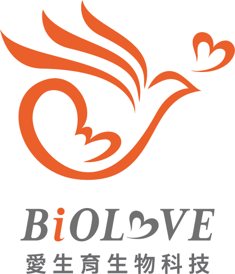

# Laboratory Overview（生殖遺傳檢測實驗室概覽）

*圖說：BiOLOVE（愛生育生物科技）品牌識別視覺（來源：`assets/biolove-6.png`）。*

> **重要合規聲明（一般性專業知識 vs. 本實驗室實際規格）**：本頁所述之組織架構、儀器分區、檢測平台與品質規範係依據 ESHRE 2020 與 ASRM 2023 國際指引整理之**一般性專業知識**，**不代表本實驗室已取得之特定認證、既有標準作業程序（SOP）或實測技術規格**。凡涉及本實驗室實際設備型號、檢測量能、報告週期（TAT）與已取得之認證證書編號，均標示為**待確認本實驗室實際規格**，須由實驗室主管人工審核補充。

## Overview

現代生殖遺傳檢測實驗室的核心使命，是在生殖醫學中心（IVF 單位）與臨床遺傳團隊的緊密協作下，針對體外受精胚胎微量細胞或備孕成人檢體執行高精準度分子遺傳分析，涵蓋 [PGT-A](../products/pgt-a.md)、[PGT-SR](../products/pgt-sr.md)、[PGT-M](../products/pgt-m.md) 與 [ECS](../products/ecs.md) 四大領域 [SRC-003] [SRC-007]。

## Key Concepts（國際指引建議之多專業協作架構）

依據 ESHRE 2020 組織指引（[SRC-007]）與 ASRM 2023 指引（[SRC-006]），完整的 PGT 醫療與實驗室服務屬於高度跨領域（multidisciplinary）體系，通常由以下角色協同運作：

1. **生殖醫學專科醫師**：負責不孕評估、臨床適應症判斷、誘導排卵、胚胎植入與妊娠追蹤 [SRC-007]。
2. **臨床胚胎師（Clinical Embryologists）**：於 IVF 實驗室執行受精、囊胚培養、顯微切片（[Embryo Biopsy](../concepts/embryo-biopsy.md)）、檢體清洗裝管（Tubing）與玻璃化冷凍 [SRC-008]。
3. **遺傳實驗室科學家與分子檢驗人員**：負責事前建置驗證（preclinical work-up）、全基因體放大（WGA）、NGS / 晶片 / PCR 實驗操作、生物資訊判讀與雙重審核 [SRC-004] [SRC-005] [SRC-007]。
4. **臨床與實驗室端遺傳諮詢師（Genetic Counselors）**：協助個案審核、檢前／檢後諮詢與複雜結果溝通 [SRC-006] [SRC-007]。

## Detailed Explanation（一般性實驗室技術與硬體分區原則）

### 1. 空間分區與防污染設計（一般性專業知識）
由於 PGT 檢體僅含極微量細胞 DNA，極易受外源 DNA 或先前 PCR 擴增產物（amplicons）污染，ESHRE 2020 指引建議分子遺傳實驗室維持嚴格的單向動線與實體分區（如檢體前處理與 pre-PCR 區、擴增區與 post-PCR 分析區隔離），並搭配獨立耗材、紫外線／防污染清潔管理與無粉丁腈手套等防護規範 [SRC-005] [SRC-008]。

### 2. 核心檢測平台對應（分產品獨立管理：已確認 vs. Pending Technical Verification）

- **已確認之實驗室定序技術**：本實驗室使用 **Thermo Fisher Scientific** 之 **Ion Torrent NGS** 定序技術（詳細分產品規格管理與佐證需求見 [NGS Technology](ngs-technology.md)）。
- **禁止跨產品推論原則**：**不可假定 PGT-A、ECS、PGT-SR、PGT-M 四項產品共用相同的定序儀、晶片、實驗流程或分析方法**，亦不得以 Thermo Fisher 原廠性能規格代替本實驗室實際驗證結果。

| 檢測產品 | 國際常見分子平台（一般參考） | 本實驗室已確認資訊 | Pending Technical Verification（待正式文件佐證） |
| :--- | :--- | :--- | :--- |
| **[PGT-A](../products/pgt-a.md)** | WGA + NGS 或 aCGH [SRC-004] | 實驗室採用 Thermo Fisher Scientific / Ion Torrent NGS 技術；**晶片 `520`（Ion 520）**；**覆蓋深度常規 `0.005×`、最高 `0.02×`** | 具體儀器型號、是否與他項共用流程、Read Length、CNV/Aneuploidy 最小偵測解析度、Mosaic 偵測下限、分析靈敏度／特異度與 TAT |
| **[ECS（iGene）](../products/ecs.md)** | 目標基因套組 NGS 搭配特定基因輔助檢測 [SRC-003] [SRC-009] | 對應 **iGene** 官方 15 大類 350 種疾病（351 個去重獨立基因，含 28 個 X 性聯基因）[SRC-009]；**晶片 `530`（Ion 530）** | 具體儀器型號與流程共用狀態、ECS 定序 Coverage、Read Length、各變異類型分析靈敏度／特異度、Low-VAF 門檻與 TAT |
| **[PGT-SR](../products/pgt-sr.md)** | WGA + NGS / aCGH / SNP Array，或極小片段 FISH [SRC-004] | 僅保留國際指引一般性技術說明 | 實際平台與是否共用 PGT-A 流程、Coverage、最小偵測片段（Mb）、平衡帶因區分能力、分析靈敏度／特異度與 TAT |
| **[PGT-M](../products/pgt-m.md)** | 多重 PCR + STR，或 WGA + SNP Array / Targeted NGS [SRC-005] | 僅保留國際指引一般性技術說明 | 實際平台與是否共用流程、Coverage（若採 NGS）、各變異類型分析靈敏度／特異度、事前開發週期與 TAT |

### 3. 院內實驗室 vs. 跨機構送檢（Transport PGT）
ESHRE 2020 指出，切片後的胚胎檢體可於同機構內進行遺傳分析，亦可透過 **Transport PGT（跨中心運送檢測）** 模式由 IVF 中心完成切片裝管後運送至專責參考遺傳實驗室分析；採取跨機構合作時，雙方必須訂定明確書面協議、統一標示格式與運送溫控及交接簽收規範（詳見 [檢體追溯](sample-traceability.md)）[SRC-007]。

## Limitations & Pending Verification

- 本頁目前不包含本公司／本實驗室之實際實驗室認證證號（如 ISO 15189、CAP、LDTS 等）、實際儀器型號、分析軟體版本、報告週期或院所實測無結果率；**待相關負責人審核並提供經核准之公司官方規格後再行納入**。

## Related Pages

- [PGT 檢測完整作業流程](pgt-workflow.md)
- [實驗室品質管理與風險控管](quality-management.md)
- [檢體標示、雙人見證與全程追溯](sample-traceability.md)
- [PGT-A 檢測產品頁](../products/pgt-a.md)
- [ECS 檢測產品頁](../products/ecs.md)
- [PGT-SR 檢測產品頁](../products/pgt-sr.md)
- [PGT-M 檢測產品頁](../products/pgt-m.md)

## Sources

- **[SRC-003]** Gregg AR et al.; ACMG (2021). *Screening for autosomal recessive and X-linked conditions during pregnancy and preconception: a practice resource of the ACMG*.
- **[SRC-004]** ESHRE PGT-SR/PGT-A Working Group (2020). *ESHRE PGT Consortium good practice recommendations for the detection of structural and numerical chromosomal aberrations*.
- **[SRC-005]** ESHRE PGT-M Working Group (2020). *ESHRE PGT Consortium good practice recommendations for the detection of monogenic disorders*.
- **[SRC-006]** ASRM Practice Committee & GCPG (2023). *Indications and management of preimplantation genetic testing for monogenic conditions: a committee opinion*.
- **[SRC-007]** ESHRE PGT Consortium Steering Committee (2020). *ESHRE PGT Consortium good practice recommendations for the organisation of PGT*.
- **[SRC-008]** ESHRE PGT Consortium & SIG-Embryology Biopsy Working Group (2020). *ESHRE PGT Consortium and SIG Embryology good practice recommendations for polar body and embryo biopsy for PGT*.
- **[SRC-009]** 愛生育銀行／送子鳥生殖中心（2026）. *iGene 遺傳疾病帶因篩檢官方產品頁與完整疾病列表*（`https://www.icryobank.com/gene/igene`、`https://www.icryobank.com/gene/igene-disease-list`）；另含實驗室主管確認之 Thermo Fisher Scientific NGS 平台廠牌資訊。
